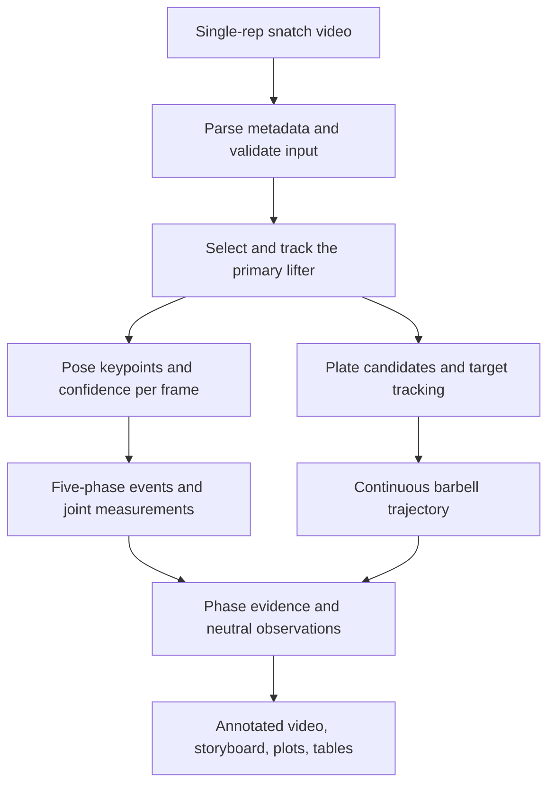

# Snatch Coach Analysis V1 - Plan

## Goal Capsule

- **Objective:** 측면에서 촬영한 스내치 1회 영상을 분석해 동작 구간, 관절 각도, 바벨 궤적과 관찰 근거를 제공하는 코치 보조 프로토타입을 만든다.
- **Product authority:** 일반인·초심자·중급자를 지도하는 크로스핏 코치, 트레이너, 생활체육 역도 코치가 주 사용자이며 최종 자세 판단 권한을 가진다.
- **Active scope:** 이 계획은 단일 영상·단일 스내치 반복의 측정과 규칙 기반 관찰만 다룬다.
- **Open blockers:** 요구사항 단계의 차단 항목은 없으며 데이터 위치와 실제 분포는 구현 계획에서 확인한다.

---

## Product Contract

### Summary

고정에 가까운 측면 스내치 영상에서 주동작 선수를 추적하고, 다섯 동작 구간의 관절 측정과 원판 기반 바벨 궤적을 함께 제공한다.
출력은 코치의 판단을 돕는 측정 근거와 관찰 후보이며 자동 자세 점수나 정답 판정이 아니다.

### Problem Frame

현재 코치는 영상을 프레임 단위로 천천히 재생하며 Set-up부터 Recovery까지 구간을 찾고, 자세와 바벨 움직임을 반복해서 비교한다.
이 과정은 시간이 걸리고 같은 기준으로 여러 반복을 검토하기 어렵다.

보유 데이터는 평균 약 4초인 MP4 영상 54개로 작고, 국가대표 선수·중급자·초심자가 섞여 있다.
일부 영상은 Catch까지만 존재하며 사용 중량, 개인 근력, 정확한 역도 경력 정보가 없다.
가벼운 중량에서는 좋지 않은 자세로도 바벨 궤적을 인위적으로 만들 수 있으므로 궤적만으로 기술 수준을 판정할 수 없다.

### Key Decisions

- **Coach-in-the-loop product.** (session-settled: user-directed — chosen over athlete self-assessment: 일반인 지도 현장에서 코치가 근거를 검토하고 최종 판단해야 한다.) Governs R1, R17-R20.
- **Single-rep snatch only.** (session-settled: user-directed — chosen over supporting snatch and power snatch together: 현재 데이터에는 파워스내치가 없다.) Governs R2, R3, R4.
- **Per-frame tracking with phase-focused review.** (session-settled: user-approved — chosen over full continuous phase judgment: 핵심 순간의 측정 신뢰성을 먼저 확보한다.) Governs R7, R8, R17.
- **Pose and plate detection in V1.** (session-settled: user-directed — chosen over a pose-only first product: 포트폴리오에서 Pose Estimation과 Object Detection을 모두 다룬다.) Governs R7, R10-R14.
- **Measurement before thresholds.** (session-settled: user-directed — chosen over fixed expert thresholds or an elite-reference range: 중량과 개인 능력 정보가 없어 기준을 먼저 정답으로 둘 수 없다.) Governs R15-R17, R23.
- **Failure-driven camera handling.** (session-settled: user-approved — chosen over stabilization from the start: 대부분 영상의 흔들림이 궤적을 바꿀 정도로 크지 않다.) Governs R5.

### Actors

- A1. **Coach or trainer:** 영상을 선택하고 자동 선택 결과를 확인하며 측정 근거로 최종 피드백을 판단한다.
- A2. **Lifter:** 분석 대상 영상에서 스내치를 수행하지만 V1의 직접 조작 사용자는 아니다.
- A3. **Domain validator:** 초기에는 사용자의 5년 국가대표 트레이너 경험으로 라벨과 관찰을 검토하고, 후속 단계에서 역도 국가대표 코치가 기준을 보정할 수 있다.
- A4. **Analysis system:** 선수와 원판을 추적하고 측정값, 신뢰도, 처리 불가 사유를 생성한다.

### Requirements

**Input and metadata**

- R1. 시스템은 코치가 선택한 측면 MP4 영상 1개를 분석하고 최종 판단을 대신하지 않는다.
- R2. 파일명에서 선수 그룹·ID, 동작 종류, 완료 범위와 반복 인덱스를 읽을 수 있어야 하며 예시는 `a01_sn_f_01`이다.
- R3. V1은 `sn`만 지원하고 다른 동작 표기는 잘못 분석하지 않고 지원하지 않는 입력으로 알린다.
- R4. `f` 영상은 Recovery까지 분석하고 `h` 영상은 Drop Under & Catch까지 분석한 뒤 Recovery를 `N/A`로 표시한다.
- R5. V1은 고정에 가까운 측면 영상을 기본 입력으로 가정하며 궤적 실패가 확인되기 전에는 영상 안정화를 요구하지 않는다.
- R6. 주변 사람이 보이더라도 크기·중심 위치·시간적 연속성으로 주동작 선수 후보를 선택하고 코치가 잘못된 선택을 수정할 수 있어야 한다.

**Phase and pose measurements**

- R7. 시스템은 모든 프레임에서 선택된 선수의 관절 좌표와 신뢰도를 추적해야 한다.
- R8. 결과는 아래 다섯 구간 순서로 구성하고 각 구간의 대표 프레임과 측정값을 보여줘야 한다.
  - `Set-up`: 바벨이 지면에서 움직이기 전
  - `First Pull`: 바벨이 지면을 떠난 시점부터 무릎 부근까지
  - `Second Pull`: 무릎 통과 이후부터 최대 신전까지
  - `Drop Under & Catch`: 최대 신전 이후부터 캐치가 안정된 시점까지
  - `Recovery`: 캐치 이후 완전히 일어선 시점까지
- R9. 관절 3개의 좌표로 내부 각도를 계산하고 몸통·무릎·엉덩이·팔꿈치 등 선택된 측정값을 프레임 및 구간과 연결해야 한다.
- R10. 견갑골 상승과 실제 무게중심처럼 COCO 관절점으로 직접 측정할 수 없는 항목은 각각 어깨 상승 추정값과 균형 위치 대리지표로 명시해야 한다.

**Plate detection and barbell trajectory**

- R11. V1은 원판 Object Detection 결과로 들어 올리는 바벨의 위치 후보를 얻어야 한다.
- R12. 원판 후보는 선수와의 위치 관계와 프레임 간 연속성을 이용해 동일 대상을 추적하며 코치가 초기 선택을 확인하거나 수정할 수 있어야 한다.
- R13. 원판 bbox 중심을 프레임별로 연결해 연속 바벨 궤적을 만들고 원본 영상 위 경로와 정규화된 전후 이동값을 함께 제공해야 한다.
- R14. 원판이 없는 영상은 Pose 결과를 유지하고 바벨 궤적만 `N/A: 원판 없음`으로 처리해야 한다.

**Feedback and interpretation**

- R15. 첫 규칙 기반 피드백은 바벨의 전후 이탈 측정으로 시작하며 임시 기준값은 블라인드 라벨과 측정값을 비교한 후 결정해야 한다.
- R16. 좋은 바벨 궤적은 좋은 자세를 보장하지 않으며 시스템은 궤적만으로 자세 양호 판정을 내려서는 안 된다.
- R17. 각 구간은 수치, 대표 프레임, 신뢰도와 중립적 관찰 문장을 제공하고 자동 규칙이 없는 측정에는 합격·불합격 표현을 사용하지 않는다.
- R18. 사용 중량·근력·경력을 알 수 없으므로 파워, 수행 난이도, 기술 수준이나 오류 원인을 단정하지 않는다.
- R19. 낮은 관절 또는 원판 신뢰도, 가림, 탐지 누락이 있으면 피드백을 억지로 생성하지 않고 확인이 필요한 이유를 보여줘야 한다.

**Outputs and experiment workflow**

- R20. 한 번의 분석은 관절과 원판이 표시된 영상, 다섯 구간 스토리보드, 각도 표·그래프, 바벨 궤적, 관찰 후보와 신뢰도를 각각 제공해야 한다.
- R21. 결과는 다시 모델을 실행하지 않고 비교·시각화할 수 있도록 프레임 단위 측정과 영상 단위 요약으로 저장해야 한다.
- R22. 실험 노트북은 설정·실행·시각화·해석을 셀 단위로 나누고 재사용 가능한 처리 로직은 노트북 밖의 모듈에 둬야 한다.
- R23. 첫 검증은 원본 영상만 보고 작성한 핵심 이벤트와 오류 라벨을 사용하고, 나머지 개발 데이터는 모델 제안을 수정하는 방식으로 사용할 수 있다.
- R24. 데이터 분할과 검증은 같은 영상이나 같은 사람의 인접 프레임이 학습과 검증에 동시에 들어가 성능이 부풀려지지 않도록 영상·사람 ID 단위로 이뤄져야 한다.

**Engineering constraints**

- R25. 환경과 의존성은 `uv`로 관리하고 MacBook M2 Air 8GB에서 반복 실험할 수 있는 기본 설정을 제공해야 한다.
- R26. 직접 사용하는 라이브러리는 우선 OpenCV, PyTorch, NumPy, Ultralytics, pandas, matplotlib, torchvision으로 제한하고 추가 라이브러리는 사용자 승인 후 도입한다.
- R27. 실험 설정은 Python 구성으로 분리하고 모델 이름·입력 크기·신뢰도 기준처럼 바꿀 값은 노트북 전체를 수정하지 않고 변경할 수 있어야 한다.
- R28. 단일 파일에 기능을 몰아넣지 않고 비디오 입출력, 메타데이터, Pose, 원판 탐지, 기하 계산, 구간 분석, 피드백, 시각화를 분리 가능한 책임으로 유지해야 한다.

### Key Flow

- F1. Single-video coach review
  - **Trigger:** A1이 스내치 영상 1개를 선택한다.
  - **Actors:** A1, A4
  - **Steps:** 입력 검증, 선수 선택 확인, 프레임별 Pose·원판 추적, 다섯 구간 구성, 측정 및 관찰 출력 순서로 진행한다.
  - **Outcome:** A1은 원본 영상을 반복 탐색하지 않고 구간별 근거를 검토한다.
  - **Covers:** R1-R22.
- F2. Blind validation
  - **Trigger:** 기준값 또는 피드백 규칙의 신뢰성을 평가한다.
  - **Actors:** A1, A3, A4
  - **Steps:** 모델 결과를 보지 않고 핵심 이벤트와 오류를 라벨링한 뒤 모델 측정과 비교하고 임시 기준을 기록한다.
  - **Outcome:** 측정과 피드백의 차이가 수치와 실패 사례로 남는다.
  - **Covers:** R15, R23, R24.
- F3. Partial-result handling
  - **Trigger:** `h` 영상, 원판 없는 영상 또는 낮은 신뢰도 구간이 입력된다.
  - **Actors:** A1, A4
  - **Steps:** 가능한 분석은 유지하고 불가능한 항목만 `N/A`와 사유로 표시한다.
  - **Outcome:** 일부 정보 부족이 전체 분석 실패나 잘못된 판정으로 바뀌지 않는다.
  - **Covers:** R4, R14, R19.

### Acceptance Examples

- AE1. **Covers R4, R7-R13, R20.** Given 원판이 장착된 `f` 영상이 입력되고 관절과 원판 신뢰도가 충분할 때, When 분석을 실행하면, Then 다섯 구간과 연속 바벨 궤적이 모두 생성된다.
- AE2. **Covers R4, R20.** Given 원판이 장착된 `h` 영상이 입력될 때, When 분석을 실행하면, Then Drop Under & Catch까지 결과를 제공하고 Recovery는 `N/A: 영상 종료`로 표시한다.
- AE3. **Covers R14, R20.** Given 원판 없는 영상이 입력될 때, When Pose가 정상적으로 탐지되면, Then 구간·관절 결과는 제공하고 바벨 궤적만 `N/A: 원판 없음`으로 표시한다.
- AE4. **Covers R6, R12.** Given 배경에 다른 사람이 보일 때, When 시스템이 주동작 선수와 원판 후보를 제안하면, Then 코치는 선택을 확인하고 잘못된 경우 분석 전에 수정할 수 있다.
- AE5. **Covers R15-R18.** Given 가벼운 중량으로 궤적은 안정적이지만 자세 측정에 이상이 있는 영상일 때, When 결과를 생성하면, Then 시스템은 궤적이 안정적이라는 관찰만 표시하고 자세가 좋다고 결론 내리지 않는다.
- AE6. **Covers R19.** Given 가림이나 탐지 흔들림으로 특정 구간의 신뢰도가 낮을 때, When 피드백을 생성하면, Then 해당 구간의 단정적 피드백을 생략하고 확인이 필요한 이유를 표시한다.
- AE7. **Covers R3.** Given `psn`처럼 지원하지 않는 동작 표기가 입력될 때, When 입력을 검증하면, Then 스내치 규칙을 적용하지 않고 지원하지 않는 동작임을 알린다.

### Success Criteria

우선순위는 측정 신뢰성, 피드백 정확도, 전체 처리율 순서다.

1. **Measurement reliability:** 블라인드 세트에서 핵심 이벤트 프레임 차이, 각도 차이, 원판 중심 추적 실패를 기록하고 코치가 실제 검토에 사용할 수 있는지 확인한다.
2. **Feedback accuracy:** 바벨 궤적 관찰 라벨의 `있음`, `없음`, `판단 어려움`과 규칙 결과를 비교하고 오탐·미탐 사례를 공개한다.
3. **Processing coverage:** 앞의 두 기준을 평가한 뒤 54개 영상 전체에서 성공, 부분 성공, 실패와 사유의 분포를 보고한다.
4. **Reproducibility:** 같은 입력과 설정으로 저장된 프레임 측정, 요약 표와 시각화를 다시 생성할 수 있어야 한다.

### Scope Boundaries

**Deferred for later**

- 같은 사람의 여러 반복 또는 이전 촬영 결과를 비교하는 변화 추세 분석
- 파워스내치 지원과 동작별 규칙 분리
- 상체 각도·캐치 자세 등 추가 자동 피드백 규칙의 도메인 보정
- 실패 사례가 필요성을 보여줄 때의 영상 안정화
- 핵심 분석 신뢰성이 확보된 뒤의 ONNX 경량화와 배포 성능 비교

**Outside this product's identity**

- 학습 기반 종합 자세 점수 또는 엘리트 경기력 순위
- 코치를 대체하는 자동 정답 판정과 선수 단독 자가진단
- 중량·근력·경력 정보 없이 수행하는 파워·난이도·원인 판정
- 의학적 진단, 부상 위험 예측 또는 치료 조언
- V1 단계의 FastAPI, Docker, AWS 제품 배포

<!-- ce-section: work-relationships -->
### How This Work Fits Together

이 계획은 단일 스내치 반복을 분석하는 코어를 소유하며 아래 항목은 현재 이해한 후속 후보이지 확정 로드맵이 아니다.

- **Depends on:** 데이터 인벤토리와 블라인드 라벨이 측정·피드백 검증의 근거가 된다.
- **Enables:** 동일 인물의 반복 비교는 이 계획의 프레임 및 영상 단위 결과를 재사용할 수 있다.
- **Enables:** 학습 기반 자세 모델은 더 많은 영상과 코치 검증 라벨이 쌓인 뒤 별도 계획으로 다룰 수 있다.
- **Depends on:** API·컨테이너·클라우드 배포는 분석 코어의 입력·출력 계약과 성능이 안정된 뒤 설계한다.

### Dependencies and Assumptions

- 데이터는 스내치 MP4 54개이며 평균 길이는 약 4초이고 대부분 2MB 이하다.
- 영상 집단은 A 국가대표 선수, B 크로스핏 코치·트레이너, C 초심자로 구성되지만 집단 표기는 정답 자세 라벨이 아니다.
- 약 52개 영상에는 원판이 장착되어 있고 2개에는 원판이 없다.
- 대부분 삼각대 촬영이며 일부 A 영상에 작은 흔들림이 있다.
- 주동작 선수 외 사람이 일부 영상에 보이지만 주동작 선수가 가장 크고 화면 중심에 가깝다.
- 사용 중량, 개인 근력, 정확한 역도 경력은 알 수 없다.
- 제공된 학습용 노트북의 데이터 확인, EDA, baseline, 지표, 실패 사례, 실험 비교 흐름을 교육적 실험 구조의 참고로 사용한다.

### Outstanding Questions

**Deferred to Planning**

- 영상 데이터의 실제 경로와 A/B/C, `h/f`, 고유 인물 ID별 개수를 인벤토리에서 확인한다.
- 블라인드 검증 세트의 개수와 구성은 실제 데이터 분포와 영상 품질을 본 뒤 정한다.
- Pose 모델 크기, 입력 해상도와 추론 설정은 MacBook M2 Air 8GB에서 짧은 benchmark 후 정한다.
- 원판 라벨링 단위와 초기 대상 선택 교정 방식은 추가 라이브러리 없이 가능한 최소 흐름을 우선 설계한다.
- 바벨 이탈 임시 기준값과 신뢰도 기준은 블라인드 라벨 및 baseline 결과에서 산출한다.

### Sources and Research

- [Ultralytics COCO detection dataset](https://docs.ultralytics.com/datasets/detect/coco): 사전학습 탐지 데이터는 80개 클래스를 제공하지만 바벨과 원판 클래스는 포함하지 않는다.
- [Ultralytics COCO-Pose dataset](https://docs.ultralytics.com/datasets/pose/coco): 기본 사람 Pose는 코·눈·귀·어깨·팔꿈치·손목·엉덩이·무릎·발목의 17개 관절점을 사용한다.
